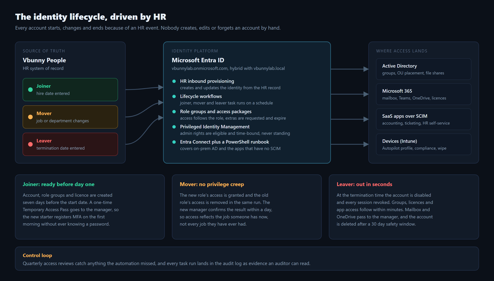
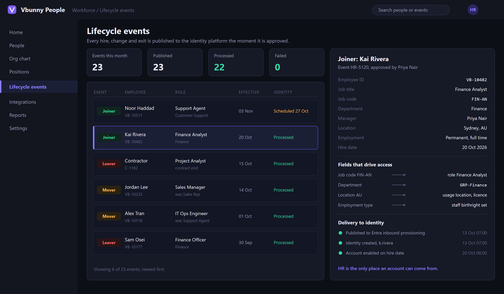
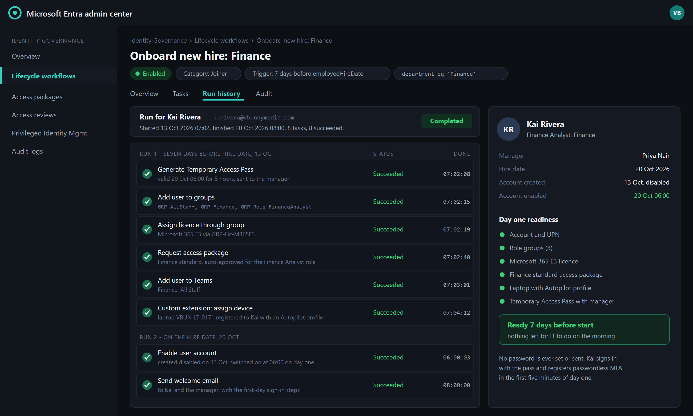
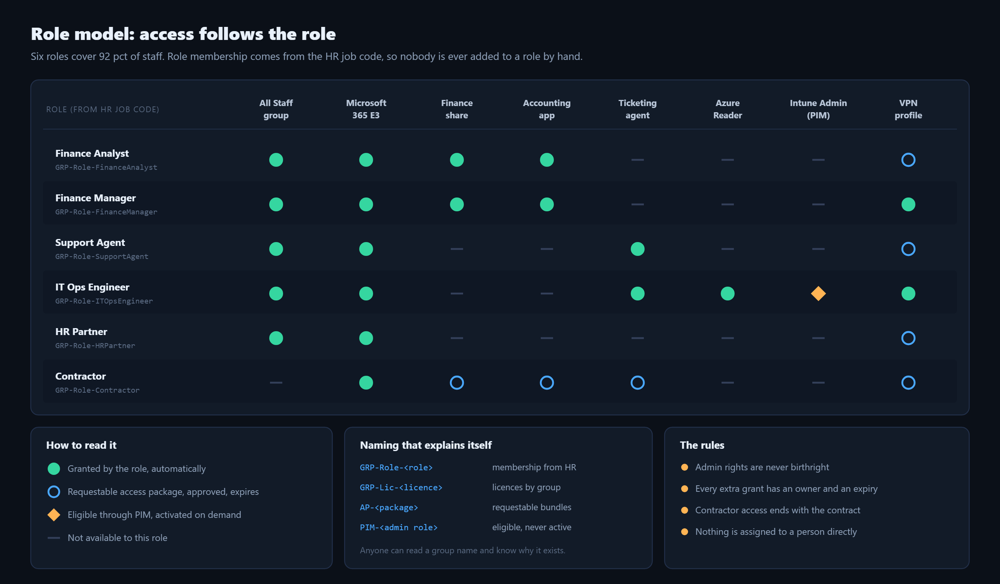
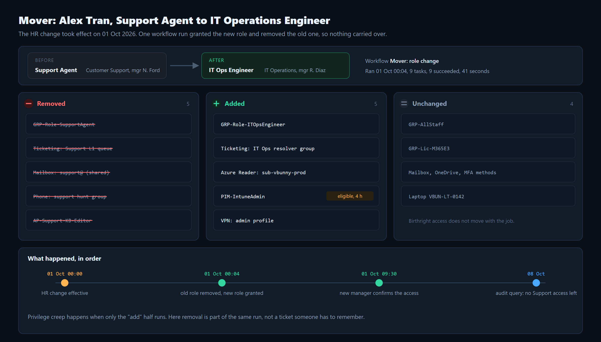
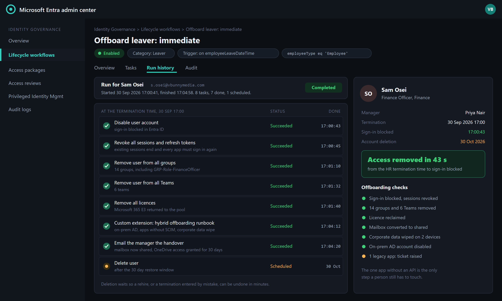
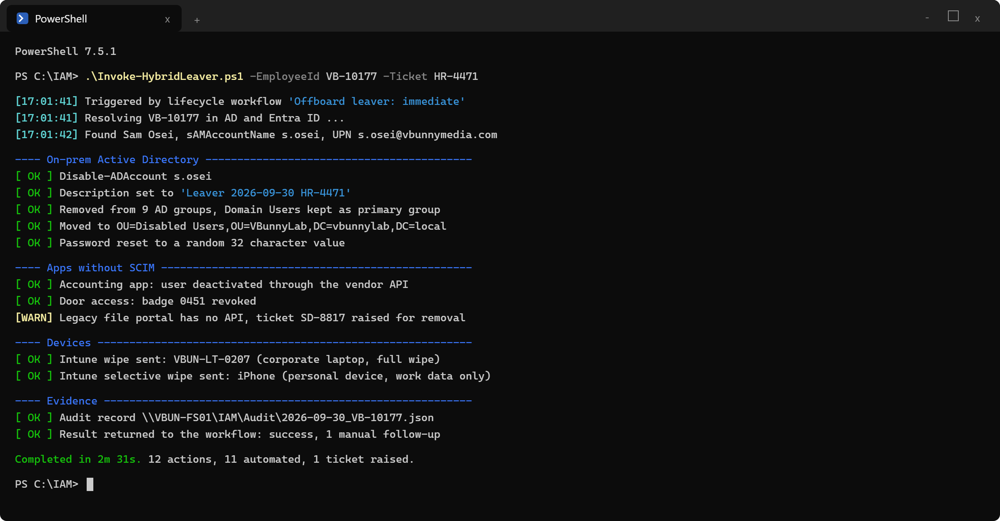
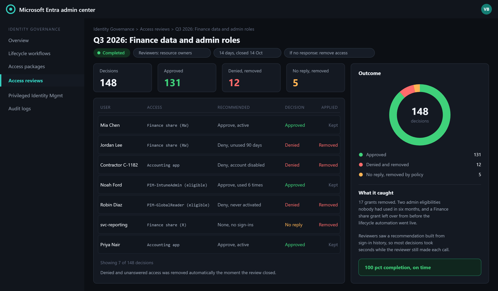
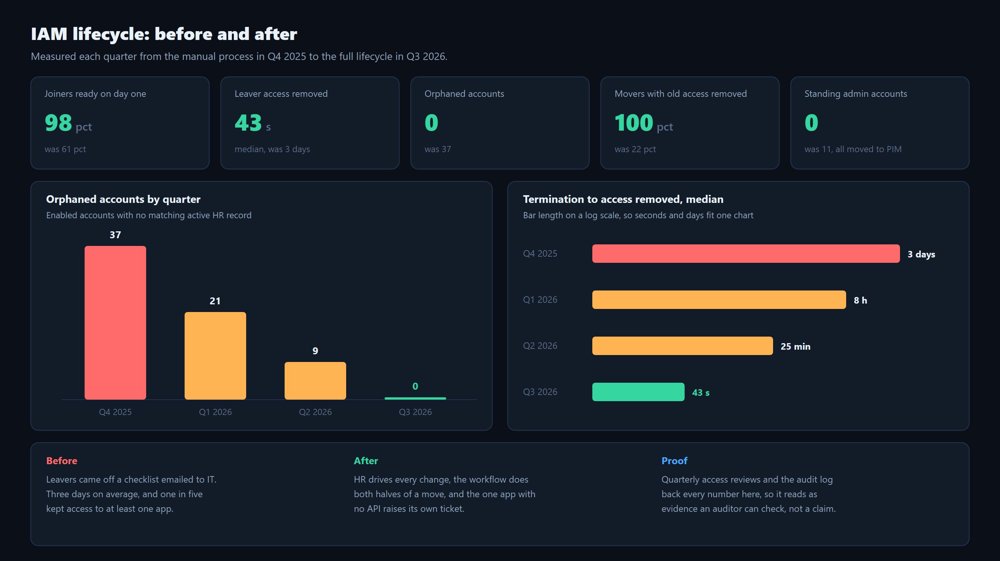

# IAM-01: Joiner, Mover, Leaver Identity Lifecycle

**Role target:** IAM Analyst, Identity and Access Management Engineer, Identity Governance
**Theme:** Make HR the only way an account is created, changed or removed, so access always matches the job someone has today.
**Environment:** The same fictional small company the rest of this portfolio models, `vbunnylab`, hybrid on-prem AD and Microsoft Entra ID
**Stack:** Entra ID inbound provisioning, Lifecycle workflows, access packages, access reviews, Privileged Identity Management, Entra Connect, PowerShell with the Microsoft Graph and ActiveDirectory modules

> Everything here is built in my lab tenant. The company and the people are fictional. It shows the design, the configuration and the evidence an identity team produces when the joiner, mover and leaver process is done properly.

---

## The Problem

Most small companies run identity from memory. A manager emails IT about a new starter, someone builds the account by copying a colleague, and the new person inherits every group the colleague ever collected. When people change jobs they get the new access and keep the old. When they leave, someone works through a checklist, eventually.

Before this project, that was vbunnylab:

- Leavers kept working access for **three days** on average, and one in five kept access to at least one app.
- **37 enabled accounts** belonged to nobody: former staff, finished contractors, test accounts.
- Only **22 pct of movers** had their old access removed.
- **11 accounts** held admin rights all day, every day.

None of that needs an attacker to hurt you. An ex-employee with a working login, or a mover quietly holding Finance access in a Sales job, is the incident before the incident.

## The Result

| Measure | Before | After |
| --- | --- | --- |
| Leaver access removed | 3 days median | 43 seconds median |
| Joiners ready on day one | 61 pct | 98 pct |
| Orphaned accounts | 37 | 0 |
| Movers with old access removed | 22 pct | 100 pct |
| Standing admin accounts | 11 | 0, all eligible through PIM |
| Access review completion | never run | 100 pct, 17 grants removed in the first review |

---

## The Design

Five rules shape everything else:

1. **HR is the source of truth.** An account exists because HR says a person works here, and only for as long as HR says so.
2. **Access follows the role, not the person.** Role groups come from the HR job code. Nobody is added to a role by hand.
3. **The automation does both halves.** A move grants the new access and removes the old in the same run. Removal is never a separate ticket.
4. **Admin rights are eligible, never standing.** Privileged roles are activated through PIM, for a few hours, with a reason.
5. **Prove it keeps working.** Quarterly access reviews and the audit log turn "we automated it" into evidence.

---

## HR Is The Source Of Truth

Every hire, change and exit in the HR system becomes a lifecycle event, published to Entra ID inbound provisioning the moment it is approved. Identity never creates an account HR does not know about, which is what makes an orphaned account structurally impossible rather than something to clean up later.

A handful of HR fields decide almost all access:

| HR field | Becomes in Entra ID | What it drives |
| --- | --- | --- |
| Employee ID | `employeeId` | the permanent key that links HR, AD and Entra ID |
| Job code | `jobTitle`, extension attribute | the role group, and through it most access |
| Department | `department` | department group and workflow scope |
| Manager | `manager` | approvals, access reviews, handovers |
| Location | `usageLocation` | licence eligibility and regional policy |
| Employment type | `employeeType` | staff or contractor birthright set |
| Hire date | `employeeHireDate` | when the joiner workflow runs |
| Termination date | `employeeLeaveDateTime` | when the leaver workflow runs |

Matching on employee ID rather than name means a name change or a duplicate name never creates a second identity.

---

## Joiner: Ready Before Day One

The joiner workflow runs seven days before the hire date. It builds everything the new person needs: role groups, a licence assigned through a group, the Finance access package, Teams, and a laptop registered to them with an Autopilot profile. The account is created disabled and switches on at 06:00 on day one.

**No password is ever set or sent.** The workflow generates a Temporary Access Pass, valid for eight hours from the start of day one, and sends it to the manager. The new starter signs in with it and registers passwordless MFA in the first five minutes. There is no initial password to leak, reuse or write on a sticky note.

---

## The Role Model

Six roles cover 92 pct of staff. Each role is a group, its membership comes from the HR job code, and the access hangs off the group. Anything outside the role is an access package: requested, approved by the manager and the resource owner, and set to expire. The remaining 8 pct are mostly single-person roles, which get a role group of their own rather than an exception.

Group names explain themselves. `GRP-Role-` is a role, `GRP-Lic-` assigns a licence, `AP-` is a requestable package, and `PIM-` is an eligible admin role. Anyone reading a group name knows why it exists, which is half of what an auditor asks.

---

## Mover: No Privilege Creep

When Alex Tran moved from Support into IT Operations, the HR change triggered one run, four minutes after it took effect, that removed five Support grants and added five IT Operations grants in 41 seconds. Birthright access stayed put. The new manager confirmed the result the same morning, and a check a week later showed no Support access left behind.

The admin capability that came with the new job, Intune Administrator, arrived as an eligible PIM role. Alex activates it for four hours when the work needs it, with a reason that is logged.

Privilege creep is what happens when only the "add" half of a move runs. Here removal is part of the same run, not a task someone has to remember.

---

## Leaver: Out In Seconds

The leaver workflow fires at the termination time HR entered. Sam Osei's sign-in was blocked 43 seconds later and every session revoked two seconds after that, so an open browser tab or a phone app stops working immediately rather than when its token expires. Groups, Teams and the licence followed within the next minute.

The mailbox becomes a shared mailbox the manager can read, OneDrive access passes to the manager for 30 days, and the account itself is deleted after a 30 day window. Waiting to delete is deliberate: a rehire, or a termination entered against the wrong person, can be reversed in minutes instead of rebuilt from nothing.

### The Parts The Cloud Cannot Reach

Not everything lives in Entra ID. A custom task extension in the workflow calls a PowerShell runbook for the rest: it disables the on-prem AD account, strips its AD groups, moves it to a Disabled Users OU, deactivates the accounting app through its API, revokes the door badge, and wipes corporate data from the person's devices. The legacy file portal has no API at all, so the runbook raises a ticket for it automatically and reports that one manual step back to the workflow.

Every run writes an audit record keyed on the employee ID, with the HR ticket inside it, so "show me what happened when this person left" is one file, not an investigation.

---

## Access Reviews: Proving It Keeps Working

Automation handles the events it knows about. Access reviews catch everything else. Each quarter, resource owners review who holds Finance data and every eligible admin role. Entra ID suggests a decision from sign-in history, the reviewer decides, and anything denied or left unanswered is removed automatically when the review closes.

The first review removed 17 grants, including two admin eligibilities nobody had used in six months and a Finance share grant left over from before the lifecycle went live. That last one is the point: the review cleans up the history the automation inherited.

---

## The Result, Measured

Each number above comes from the audit log or a review export, not from a feeling that things improved. That is what lets an identity process be audited rather than trusted.

---

## Edge Cases Handled

- **Rehire within 30 days.** The account still exists, disabled, so it is switched back on with its mailbox and history, and the joiner workflow grants access for the new role.
- **Long leave.** Parental or extended leave disables the account on the leave date and re-enables it on return. Nothing is deleted.
- **Emergency termination.** HR can enter an immediate termination, or the identity team can run the leaver workflow on demand for a single person. Both reach sign-in blocked inside a minute.
- **Contractors.** Every contractor has an end date and a sponsor. Access expires on the end date even if nobody remembers to tell HR.
- **Name changes.** Matching on employee ID means the UPN and display name update in place. No second account is created.
- **Break-glass accounts.** The two emergency admin accounts are excluded from every workflow and every review that could disable them, and their sign-ins alert the security team.

---

## What This Demonstrates

- Designing an identity lifecycle around an authoritative source, not around tickets.
- Role-based access control that maps HR data to groups, with requestable and expiring exceptions.
- Microsoft Entra ID Governance in depth: inbound provisioning, lifecycle workflows, access packages, access reviews and PIM.
- Hybrid identity, covering on-prem AD and apps with no SCIM through PowerShell and vendor APIs.
- Security thinking: removing access fast, killing sessions, eliminating standing privilege, and keeping a reversible window.
- Audit readiness: every change traceable to an HR event, a workflow run and an evidence record.

## Tools Used

Microsoft Entra ID, Entra ID Governance (lifecycle workflows, access packages, access reviews), Privileged Identity Management, Entra Connect, Microsoft Intune, Exchange Online, PowerShell 7 with the Microsoft Graph and ActiveDirectory modules, Windows Server Active Directory.

---

Back to the [portfolio home](../README.md).
